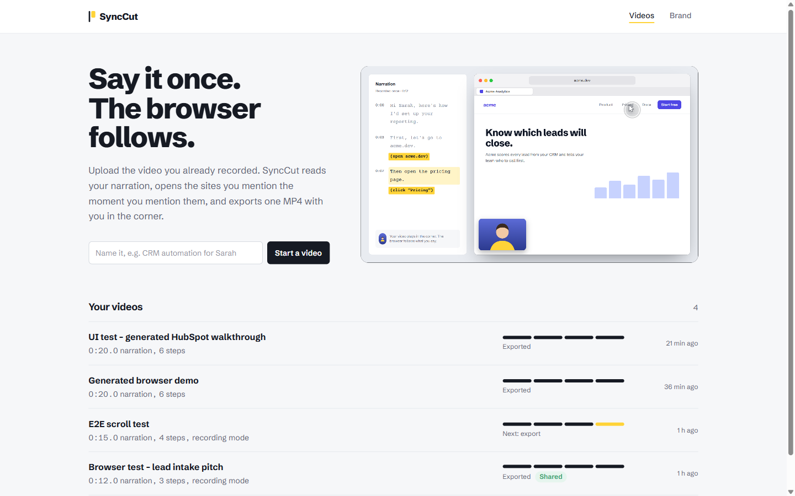
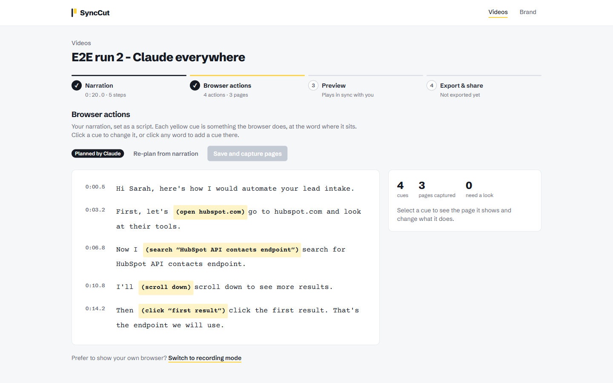
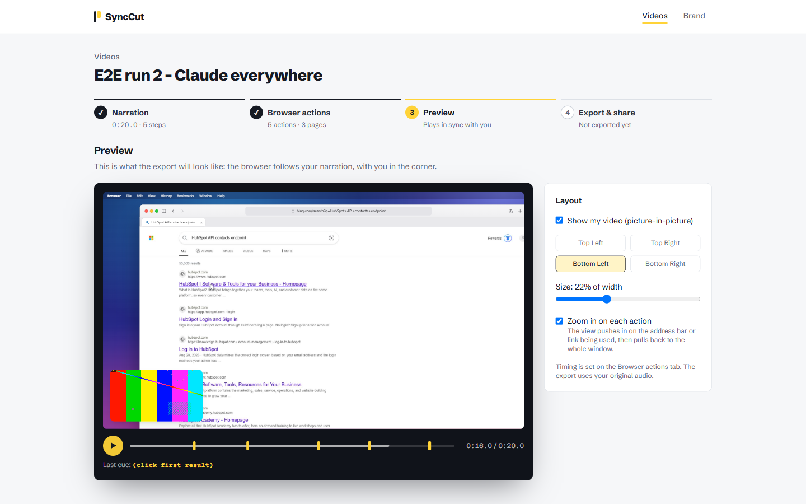
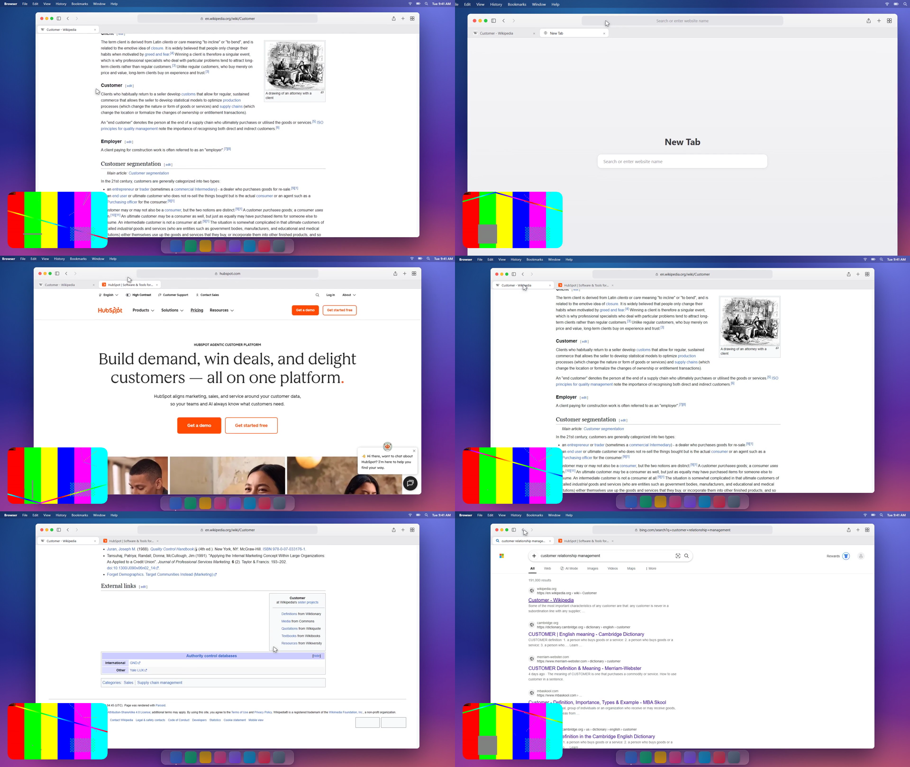

# SyncCut

**Say it once. The browser follows.**

SyncCut turns a video you've already recorded (you talking to camera) into a finished browser walkthrough. It reads your narration, opens the sites you mention at the moment you mention them, scrolls, types, clicks and switches tabs in a macOS-style browser, then exports one 1080p MP4 with you picture-in-picture and your original audio.

You never record your screen.



---

## Contents

- [What it does](#what-it-does)
- [How it works](#how-it-works)
- [Quick start](#quick-start)
- [Configuration](#configuration)
- [Using SyncCut](#using-synccut)
- [Deployment](#deployment)
- [Project structure](#project-structure)
- [Development](#development)
- [Performance](#performance)
- [Limitations and troubleshooting](#limitations-and-troubleshooting)
- [Credits](#credits)

---

## What it does

1. **Upload your narration video.** It is transcribed with word-level timestamps (local Whisper), or you import an `.srt` / `.vtt` you already have.
2. **Claude plans the browser.** Your narration is split into steps, and each spoken instruction ("go to hubspot.com", "search for…", "scroll down to the pricing", "click the first result", "open a new tab", "switch back to the first tab", "go back") becomes a timed action tied to the exact word that says it.
3. **Real pages are captured.** A headless browser runs the plan on the real sites and saves each page state. Nothing is invented: pages that can't be loaded (login walls, bot checks) become a neutral placeholder and are flagged.
4. **You review it as a script.** Your narration is set like a screenplay, with each browser action as an inline cue at its word. Click a cue to change it, or click any word to add one.

   

5. **Preview in sync.** The generated browser plays live against your narration, with you in the corner. Yellow ticks on the timeline mark every cue.

   

6. **Export.** The browser is drawn frame by frame, so sync is exact, then composited with your video and audio into an MP4. A share page under your own brand (video, proof, booking calendar) is one click away.

   

Prefer to show your real browser? **Recording mode** is still there: a Chrome extension and teleprompter let you record your own browser one step at a time, and SyncCut syncs it to your narration.

## How it works

```
narration video ──► audio ──► Whisper (word timestamps)        or  .srt/.vtt import
                                   │
                                   ▼
                   Claude: steps  ║  Claude: browser actions      (in parallel; phrase-matching fallback)
                                   │      word index → time is computed in code, never by the model
                                   ▼
                   headless Chromium runs the plan on real sites → page screenshots, links, scroll targets
                                   │
                                   ▼
                   scene.json  ──►  stage (HTML/CSS/JS macOS browser, pure seek(t))
                                   │                     │
                         preview in the editor     render: frame n = seek(n/30), 4 tabs in parallel
                                                         │
                                                         ▼
                   FFmpeg: browser track + PiP + original audio ──► 1080p MP4
```

| Part | Tech |
|---|---|
| Web app | Next.js 16 (App Router), React 19, Tailwind CSS 4 |
| API and jobs | Python 3.11, FastAPI, background job threads, JSON project store |
| Transcription | faster-whisper (local, CPU), or subtitle import |
| AI | Claude via the Anthropic SDK (API key) or the Claude Agent SDK (Claude login token) |
| Page capture and frame rendering | Playwright (Chromium) |
| Video | FFmpeg (libx264, AAC) |
| Recording mode | Chrome extension (Manifest V3) |

Design notes: [docs/GENERATED_MODE.md](docs/GENERATED_MODE.md). Full product and architecture plan: [docs/PRODUCT_PLAN.md](docs/PRODUCT_PLAN.md), [docs/BUILD_PLAN.md](docs/BUILD_PLAN.md).

## Quick start

### Requirements

- **Node.js 20+** and **Python 3.11+**
- **FFmpeg** on your `PATH`
- **Chromium for Playwright**: run `python -m playwright install chromium` once (or point `SYNCCUT_CHROMIUM` at an existing Chrome/Chromium)
- **Windows only:** the Microsoft Visual C++ Redistributable, needed by local Whisper:
  `winget install Microsoft.VCRedist.2015+.x64`
- **Optional:** a Claude credential (see [Configuration](#configuration)). Without one, steps and actions come from phrase matching.

### Install

```bash
git clone https://github.com/tahahasan01/synccut.git
cd synccut

# API
cd services/api
python -m venv .venv
.venv/Scripts/pip install -r requirements.txt        # macOS/Linux: .venv/bin/pip
.venv/Scripts/python -m playwright install chromium

# Web app
cd ../../apps/web
npm install
```

### Run

```bash
# Terminal 1: API on http://localhost:8000
cd services/api
.venv/Scripts/python -m uvicorn synccut.main:app --port 8000

# Terminal 2: web app on http://localhost:3000
cd apps/web
npm run dev
```

On Windows, `scripts/dev.ps1` starts both. Check `http://localhost:8000/api/health` to confirm FFmpeg, Whisper and Claude are available.

## Configuration

Put settings in a `.env` file at the repository root (it is git-ignored).

| Variable | Default | What it does |
|---|---|---|
| `ANTHROPIC_API_KEY` | none | A Console API key (`sk-ant-api03-…`). Used with the Anthropic SDK. |
| `ANTHROPIC_AUTH_TOKEN` | none | A Claude login token (`sk-ant-oat01-…`, e.g. from `claude setup-token`). Used through the Claude Agent SDK. An `sk-ant-oat…` value in `ANTHROPIC_API_KEY` is detected and handled the same way. |
| `SYNCCUT_CLAUDE_MODEL` | `claude-opus-5-5` | Model for step grouping and action planning |
| `SYNCCUT_WHISPER_MODEL` | `base.en` | faster-whisper model (`small.en` is more accurate, slower on CPU) |
| `SYNCCUT_DATA_DIR` | `./data` | Where projects, captures and renders are stored |
| `SYNCCUT_WEB_ORIGINS` | `http://localhost:3000,http://127.0.0.1:3000` | Allowed web origins (CORS). Add your deployed web URL here. |
| `SYNCCUT_API_BASE` | `http://127.0.0.1:8000` | How the API reaches itself when rendering the stage |
| `SYNCCUT_RENDER_WORKERS` | auto (up to 4) | Parallel browser tabs used to draw frames |
| `SYNCCUT_CHROMIUM` | newest Playwright Chromium found | Chrome/Chromium executable for capture and rendering |
| `SYNCCUT_ALLOW_PRIVATE_URLS` | off | Lets page capture open local/private addresses. **Development only**; never enable on a public server. |
| `NEXT_PUBLIC_API_URL` (web) | `http://localhost:8000` | Where the web app finds the API |

**Which Claude credential?** For your own local use, either works. If you run SyncCut as a service for other people, use a Console API key: Claude subscription tokens are meant for your own use, not for products you offer to others.

## Using SyncCut

1. **Brand:** add your name, track record, profile link, booking link (Calendly or Cal.com) and portfolio. These appear on share pages.
2. **Start a video** and upload your narration. Steps appear once it's transcribed (or click **Import subtitles**).
3. **Browser actions:** check the cues in the script. Click a cue to change its time (±0.2 s), what it does, or its target. Click any word to add a cue there. **Save and capture pages** when you're done; timing-only changes don't re-capture.
4. **Preview:** play it back, move or resize your video, and turn the zoom-on-actions camera on or off.
5. **Export & share:** export the MP4, then publish the share page.

Phrases the planner understands best: "open / go to *site*", "search for *…*", "scroll down / up / to the bottom / to *the pricing section*", "click *the first result* / *Pricing*", "open a new tab", "switch back to the first tab", "go back".

### Recording mode and the Chrome extension

Load `apps/extension` in `chrome://extensions` (Developer mode → **Load unpacked**). While a take records, it logs tab, navigation, click and scroll events and adds a next-step hotkey (`Alt+Shift+N`; set it at `chrome://extensions/shortcuts` if Chrome doesn't assign it). Passwords and payment fields are never read.

## Deployment

The web app deploys to **Vercel** as a standard Next.js project:

- **Root directory:** `apps/web`
- **Environment variable:** `NEXT_PUBLIC_API_URL` = the public URL of your API

The **API cannot run on Vercel as-is.** It renders video with FFmpeg and Chromium in long-running jobs and keeps projects on local disk. Run it on a host with a persistent disk and a few CPU cores (a VM, or a container platform such as Railway, Fly.io or Render), with FFmpeg and Playwright's Chromium installed, and add your Vercel URL to `SYNCCUT_WEB_ORIGINS`. Moving storage to object storage and jobs to a queue, as in [docs/BUILD_PLAN.md](docs/BUILD_PLAN.md), is what it takes to make the API serverless.

Share links (`/v/<slug>`) only work for clients once both the web app and the API are publicly reachable.

## Security

- **Page capture only opens public websites.** Every page, redirect, iframe, script and favicon request the capture browser makes is checked: loopback, private networks, link-local (cloud metadata), carrier-grade NAT, multicast and reserved addresses are refused, as are non-http(s) schemes and URLs with embedded credentials. Service workers are disabled in the capture browser so nothing bypasses this.
- **Captured and uploaded files are inert.** Favicons are stored only as verified PNG/JPEG/GIF/WebP/ICO (never SVG), and everything under `/media` is served with `X-Content-Type-Options: nosniff` and a sandboxed, script-free Content-Security-Policy.
- **Share-page links must be http(s).** Brand links (profile, booking, avatar, portfolio) are validated on the server and again on the page, so a `javascript:` URL can't run there. The booking calendar iframe is sandboxed.
- **Secrets stay out of git.** `.env` is ignored; credentials are read from the environment only.

## Project structure

```
apps/web/              Next.js app: videos, script editor, preview, export, share page, home demo
  src/components/demo/ animated home-page demo (interactive-product-demo skill hooks)
apps/extension/        Chrome extension for recording mode
services/api/synccut/
  main.py              FastAPI routes
  pipeline.py          jobs: analyze, plan + capture, render
  claude_client.py     Claude via API key (Anthropic SDK) or login token (Agent SDK)
  ai_beats.py          steps from the narration
  ai_actions.py        browser actions from the narration
  capture.py           runs the plan on real sites, captures pages
  stage/               the generated macOS-style browser (HTML/CSS/JS, seek(t))
  stage_render.py      frame-exact parallel rendering of the stage
  core/                pure logic: actions, scene tracks, timeline/EDL, retiming, FFmpeg compositing
services/api/tests/    pytest suite
docs/                  plans, design notes, screenshots
```

## Development

```bash
# API tests (31 tests, including real FFmpeg renders)
cd services/api && .venv/Scripts/python -m pytest -q

# Web checks
cd apps/web && npx tsc --noEmit && npm run lint && npm run build
```

## Performance

Measured on an 8-core Windows laptop, 30-second narration, 3 real pages:

| Step | Time |
|---|---|
| Subtitle import request | 0.3 s (the work runs as a background job) |
| Steps + actions (Claude, in parallel) + page capture | ~30 s |
| Export: browser frames (4 parallel workers) + compositing | ~43 s |
| Re-export after a layout change (browser video reused) | ~15 s |

## Limitations and troubleshooting

- **Whisper won't load on Windows:** install the Visual C++ Redistributable (above), then restart the API. Meanwhile, use **Import subtitles**.
- **Google search results** block automated browsers, so searches show real Bing results unless Google loads. The address bar always shows the real URL.
- **Pages behind a login** (for example an Upwork job post) and bot-protected pages can't be captured. They show a placeholder and are flagged on the Browser actions tab.
- **Captured pages are still images:** videos and animations inside a page don't play. Pages are captured up to 7,000 px tall.
- **Single user, local storage:** there are no accounts yet.

## Credits

- The home-page demo uses the beat engine, activity gate and camera from the [interactive-product-demo](https://github.com/noumansarwarr/interactive-product-demo) skill by Nouman Sarwar (MIT). Its cursor, press-ripple and camera rules also shape the generated browser.
- Built with [Claude](https://www.anthropic.com/claude).
