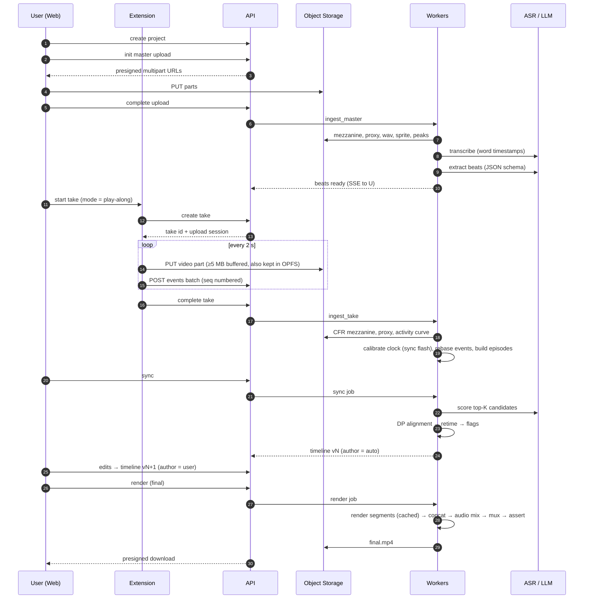
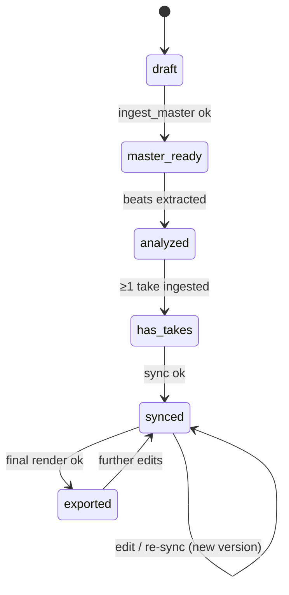
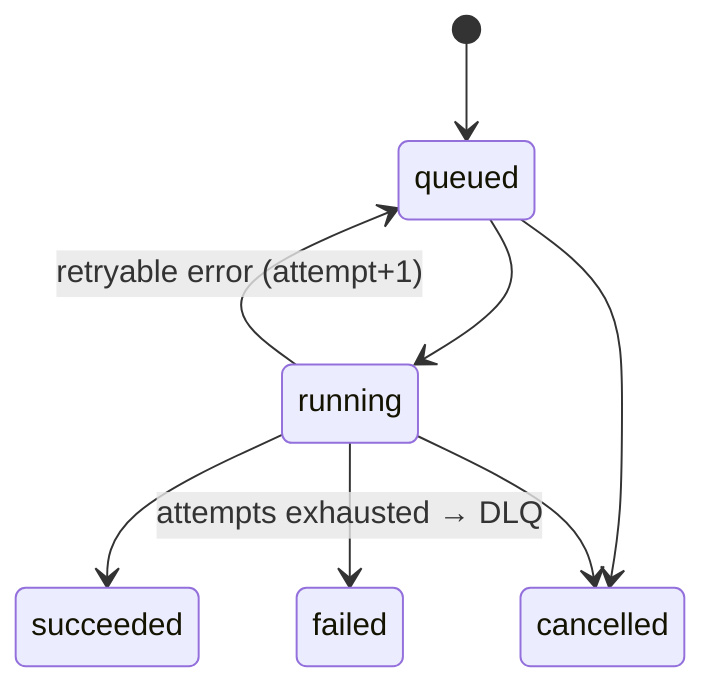

# SyncCut — System Architecture, Build Plan & Checklist

> Companion to [PRODUCT_PLAN.md](PRODUCT_PLAN.md), which holds the product rationale and deep design detail (§ references below point there).
> This file is the **engineering source of truth**: how the system fits together, what we build in what order, and how we know each piece is done.
>
> Status: draft · Last updated: 2026-10-13

**How to use this doc**
- Architecture (§1–§4): read once, then refer back to it. Change it only via an ADR in `docs/adr/`.
- Build plan (§5): phases in order. A phase starts only when the previous phase's exit criteria pass.
- Checklist (§6): tick items in PRs (`- [x]`). Every item has an ID (e.g. `P1-07`), so reference that ID in commit messages and PR titles.

---

## 0. Decisions in effect

| # | Decision | Value | Status |
|---|---|---|---|
| D1 | Who it's for | **Own/agency use first, path to SaaS.** SaaS-only items are tagged `[SaaS]` and can be deferred | Default, awaiting confirmation |
| D2 | Primary use case | Short outreach videos, 1–5 min, high volume. Limits: 30 min per video, 4 GB per file | Default, awaiting confirmation |
| D3 | Deployment model | Hosted: web + Chrome extension + cloud workers | Default, awaiting confirmation |
| D4 | Default recording mode | Play-along, with guided and free-form also available | Default, awaiting confirmation |
| D5 | Auth | Clerk (fastest), with Auth.js as fallback | Decide in Phase 0 |
| D6 | ASR | Hosted API with word timestamps, behind an adapter. faster-whisper as alternative | Decided |
| D7 | LLM | Claude, structured JSON output, used only for beats and candidate scoring | Decided |
| D8 | Capture method | Window capture (`getDisplayMedia`). Tab-follow capture gets a spike | Decided for MVP; spike in P0 |
| D9 | Job system | Celery + Redis, with state in Postgres | Decided |
| D10 | Storage | S3 API everywhere: MinIO (dev), Cloudflare R2 (prod) | Decided |

---

## 1. System architecture

### 1.1 Context

```
                ┌────────────────────────────── User's machine ──────────────────────────────┐
                │                                                                            │
                │  ┌────────────────────┐     pairing token      ┌────────────────────────┐  │
                │  │  Web App (browser) │◄──────────────────────►│  Chrome Extension MV3  │  │
                │  │  Next.js           │  externally_connectable│  recorder · events ·   │  │
                │  │  upload · editor · │                        │  teleprompter          │  │
                │  │  preview · export  │                        └───┬───────────┬────────┘  │
                │  └───┬──────────┬─────┘                            │           │           │
                └──────┼──────────┼──────────────────────────────────┼───────────┼───────────┘
                       │REST/SSE  │ presigned multipart PUT          │REST       │ presigned multipart PUT
                       ▼          ▼                                  ▼ (events)  ▼ (video parts)
   ┌───────────────────────────────┐                     ┌────────────────────────────────────┐
   │ API — FastAPI                 │  presign / verify   │ Object Storage (S3 API)            │
   │ auth · projects · uploads ·   │────────────────────►│ MinIO (dev) · R2 (prod)            │
   │ takes · events · timelines ·  │                     │ masters · takes · proxies · events │
   │ jobs · SSE progress           │                     │ · segment cache · renders          │
   └───┬──────────────┬────────────┘                     └───────────────▲────────────────────┘
       │ SQL          │ enqueue / pubsub                                 │ read/write
       ▼              ▼                                                  │
   ┌──────────┐   ┌──────────┐      ┌────────────────────────────────────┴───────────────────┐
   │ Postgres │◄──┤  Redis   │◄────►│ Workers — Celery (one image, four queues)              │
   │ source   │   │ broker + │      │  ingest │ asr │ sync │ render                          │
   │ of truth │   │ progress │      │  ffmpeg/ffprobe · services/core (pure logic)           │
   └──────────┘   └──────────┘      └───────┬───────────────────────┬────────────────────────┘
        ▲                                   │                       │
        └──────── job + entity state ───────┘                       ▼
                                                    External: ASR provider · Claude API
                                                    Sentry · OpenTelemetry collector
```

### 1.2 Components and responsibilities

| Component | Owns | Does not own | Talks to |
|---|---|---|---|
| **Web app** (`apps/web`) | Project UI, master upload, beats view, review editor, preview compositor, export UI | Media processing, sync decisions | API (REST + SSE), object storage (presigned PUT/GET), extension (pairing) |
| **Extension** (`apps/extension`) | Screen capture, browser event log, chunked crash-safe upload, teleprompter, beat markers | Any processing beyond chunking | API, object storage |
| **API** (`services/api`) | Authn/z, tenancy, CRUD, presigning, job creation, SSE fan-out, EDL validation on write | Heavy compute (never runs ffmpeg or LLM calls inline) | Postgres, Redis, object storage (metadata only) |
| **Workers** (`services/worker`) | Running pipeline tasks idempotently, writing outputs and status | HTTP serving | Postgres, Redis, object storage, ASR, LLM |
| **Core lib** (`services/core`) | Pure logic: EDL models/validator, sync engine, retiming, ffmpeg graph builder, media helpers | I/O (callers supply data and paths) | Nothing. It is imported by API and workers |
| **Schemas** (`packages/schemas`) | JSON Schemas for EDL, events, beats, episodes, DTOs. Generates TS + Pydantic code | Behavior | Build-time only |

**Boundary rule:** anything that decides *what the video looks like* (alignment, retiming, graph building) lives in `services/core` and is a pure function. That's what keeps it testable with golden fixtures.

### 1.3 End-to-end data flow



### 1.4 Job pipeline (DAG)

```
master upload complete
  └─► ingest_master ─► transcribe ─► extract_beats ─────────────┐
                                                                ├─► sync ─► timeline vN (auto)
take complete (×N)                                              │
  └─► ingest_take ─► calibrate_clock ─► build_episodes ─────────┘
                                                        user edits ─► timeline vN+k (user)

render(timeline_version, preset = draft | final)
  └─► plan_render ─► render_segment ×M (parallel, cached by hash) ─► concat ─► build_audio ─► mux ─► assert_output
```

**Rules for every task:**
1. **Idempotent.** The output key is derived from `sha256(inputs) + task_version`. If that output already exists, the task returns success without redoing work.
2. **Small and resumable.** No task should run longer than about 10 minutes, so long work is fanned out into smaller tasks.
3. **Reports progress** as 0–100% on the Redis channel `job:{id}`. The API forwards it to the browser over SSE.
4. **Retries** up to 3 times with exponential backoff, then moves to a dead-letter queue (DLQ) and raises an alert.
5. **Records its status in Postgres** so the job is visible in the app. Redis is only the transport.

### 1.5 State machines





Project status is **derived** from child entities (assets, takes, timelines, renders) and never set by hand.

### 1.6 Storage layout

```
synccut-{env}/
  u/{user_id}/p/{project_id}/
    master/original.{ext}  mezz.mp4  proxy.mp4  audio16k.wav  sprite.jpg  peaks.json
    takes/{take_id}/
      parts/{n:05}.webm            # raw recorder parts (deleted after mezzanine is verified)
      mezz.mp4  proxy.mp4  events.ndjson.gz  activity.json  keyframes/{episode_id}.jpg
    renders/{render_id}/final.mp4
  cache/segments/{sha256}.mp4      # content-addressed, shared across renders, LRU-expired
```

- Buckets are private. Every read and write uses a presigned URL with a TTL of 15 minutes or less.
- Lifecycle rules: `parts/` are deleted after 7 days. `takes/*` and proxies are deleted 30 days after export (configurable). `cache/` uses a 14-day LRU.

### 1.7 Data model (summary)

```
users ─┬─< projects ─┬─< assets          (kind, storage_key, sha256, probe JSONB)
       │             ├─< takes ──< episodes
       │             ├── transcripts (1)
       │             ├─< beats
       │             ├─< timelines       (version, parent_version, author, edl JSONB) — append-only
       │             │      └─< renders  (preset, status, output_asset_id, settings_hash)
       │             └─< jobs            (type, status, attempts, progress, input_hash, error)
       └─< extension_sessions            (scoped token, device, expires_at)
audit_log
```

Full field lists: PRODUCT_PLAN §4.1. Contracts: event schema §4.2, EDL §4.3.

### 1.8 Tech stack

| Area | Choice |
|---|---|
| JS tooling | pnpm workspaces, Turborepo, TypeScript (strict), ESLint, Prettier, Vitest, Playwright |
| Web | Next.js (App Router), React, Tailwind, shadcn/ui, TanStack Query, Zustand |
| Extension | WXT (MV3), TypeScript |
| Python tooling | uv workspace, Ruff, mypy (strict on `core`), pytest, hypothesis |
| API | FastAPI, Pydantic v2, SQLAlchemy 2 (async), Alembic, pydantic-settings |
| Workers | Celery 5, Redis 7 |
| Data | Postgres 16, S3 API (MinIO / R2) |
| Media | FFmpeg 7.x (version pinned in Docker image), ffprobe |
| AI | ASR adapter (hosted default), Claude via Anthropic SDK |
| Observability | Sentry, OpenTelemetry, structured JSON logs |
| CI/CD | GitHub Actions. Web → Vercel. API/workers → container platform (Fly.io / Railway / ECS) |

### 1.9 Repository layout

```
/apps/web                 Next.js app
/apps/extension           WXT MV3 extension
/packages/schemas         *.schema.json + codegen → ts/, py/
/packages/ui              shared React components
/services/core            pure Python: edl/, sync/, retime/, ffmpeg_graph/, media/
/services/api             FastAPI app (routers/, repos/, models/, migrations/)
/services/worker          Celery app (tasks/ingest, asr, sync, render)
/fixtures                 golden projects: media, events, ground-truth alignment, reference frames
/infra                    docker-compose.yml, Dockerfiles, IaC later
/docs                     PRODUCT_PLAN.md, BUILD_PLAN.md, adr/, runbooks/
```

### 1.10 Environments and deployment

| Env | Web | API + workers | Data | Purpose |
|---|---|---|---|---|
| local | `next dev` | docker-compose | Postgres, Redis, MinIO containers | Development |
| preview | Vercel per-PR | shared staging backend | staging data | UI review |
| staging | Vercel | 1 API + 1 worker per queue | managed PG/Redis, R2 staging bucket | Integration, chaos tests |
| prod | Vercel | API ×2+, workers autoscaled on queue depth | managed PG (PITR), Redis, R2 | Users |

Render workers need CPU-optimized instances with at least 50 GB scratch disk and a concurrency of 1–2. Don't run renders as serverless functions.

---

## 2. Key contracts (quick reference)

- **Event:** `{take_id, seq, t_ms, type, tab_id, window_id, frame_id, url, title, target{role,name,selector,bbox}, viewport}`. Inputs are masked by default. See PRODUCT_PLAN §4.2.
- **EDL:** `{schema, version, master, output, layout, audio, segments[]}`. Segment kinds are `browser | hold | face`. See PRODUCT_PLAN §4.3.
- **EDL invariants** (must hold on every write):
  1. Segments tile `[0, master.duration_ms]` with no gaps or overlaps.
  2. Every boundary is snapped to the output frame grid.
  3. In each segment, content duration (pieces ÷ speed, plus holds) fits the slot.
  4. `0.5 ≤ speed ≤ 4.0`.
  5. Every source range lies inside its take.
- **API conventions:** `Idempotency-Key` header on job-creating POSTs, RFC 7807 error bodies, cursor pagination, OpenAPI → generated TS client.

---

## 3. Cross-cutting concerns

| Concern | Approach |
|---|---|
| Timing accuracy | Single epoch clock, sync-flash calibration, CFR normalization, frame-grid snapping, post-render ffprobe assertions |
| Privacy | Input masking + denylist (password/cc/OTP). No DOM or cookie capture. Mic off. Only text goes to the LLM. Retention lifecycle rules |
| Security | Tenant scoping in the repository layer, IDOR tests per endpoint, short-TTL presigned URLs, extension CSP, `externally_connectable` locked to our origin |
| Reliability | Idempotent tasks, retries + DLQ, stuck-job reaper, OPFS-backed upload recovery, graceful worker shutdown |
| Cost | LLM limited to top-K candidates + cache by hash, segment render cache, proxies in the editor, per-user minute quotas |
| Observability | One trace ID from browser → API → worker. Dashboards: queue depth, stage p50/p95, render success, flag rate, cost per exported minute |

---

## 4. Quality targets (release gates)

| Metric | Target |
|---|---|
| Sync: correct match, play-along / guided / free-form | ≥ 97% / ≥ 95% / ≥ 80% |
| Sync: silent-error rate (wrong match with confidence ≥ τ) | ≤ 1% / ≤ 2% / ≤ 5% |
| Event-to-video clock error | ≤ 1 frame (≤ 33 ms at 30 fps) |
| Output A/V duration mismatch | ≤ 1 frame |
| Render success rate | ≥ 98% |
| Final render time (5-min video, cold cache) | ≤ 1× real time on one worker |
| Re-export after a single-segment edit | ≤ 20% of a cold render time |
| Take upload loss after a forced crash | 0 lost parts that were already in OPFS |

---

## 5. Build plan

Estimates assume **one senior full-stack developer**. With two (one on web/extension, one on backend/media), expect about 60% of the calendar time. Re-estimate at the end of Phase 0.

| Phase | Goal | Depends on | Exit criteria (all must pass) | Est. |
|---|---|---|---|---|
| **P0 Foundations + spikes** | Repo, CI, local stack, schemas; settle the riskiest unknowns | — | CI green. `docker compose up` gives a working stack. A hand-written EDL renders a correct MP4. Clock error measured at ≤ 1 frame. ADRs written for the three spikes | 1.5 wk |
| **P1 Media core** | Upload → ingest → render from an EDL | P0 | Golden render suite green across the fps/aspect matrix. Uploads of 4 GB succeed. SSE progress works | 2 wk |
| **P2 Capture extension** | Record takes reliably with events | P0, P1 (upload, ingest) | 20-min take with 10+ tab switches. Forced crash loses 0 buffered parts. Clock error ≤ 1 frame. Masking tests pass | 2.5 wk |
| **P3 Sync engine** | Auto-generate a correct EDL | P1, P2 | Golden-set eval meets the play-along and guided targets in §4 (free-form ≥ 70% for now). Eval is a CI gate | 3 wk |
| **P4 Review editor** | Fix and export without help | P3 | A test user fixes 3 flagged segments and exports in < 5 min, unaided | 2.5 wk |
| **P5 Hardening + beta** | Ready for real users | P4 | Render success ≥ 98% in staging soak. Security checklist done. No P1 bugs open for 7 days. 10 beta users onboarded | 2 wk |
| | | | **MVP total** | **~13.5 wk** |
| P6 Outreach pack | Templates, overlays, share page | P5 | A new prospect video takes < 3 min of user time | 2–3 wk |

**Critical path:** P0 spikes → P1 render core → P2 clock calibration → P3 alignment. The editor (P4) can start its UI shell during P3 using fixture EDLs.

---

## 6. Build checklist

Legend: `[SaaS]` = can be deferred under D1. Each item is done when its acceptance note is true **and** it meets the Definition of Done (§7).

### P0 — Foundations + spikes

**Repo and tooling**
- [ ] **P0-01** Monorepo set up: pnpm workspaces + Turborepo + uv workspace. Done when `pnpm i && uv sync` work from a clean clone.
- [ ] **P0-02** Lint, format and typecheck configured (ESLint, Prettier, Ruff, mypy, tsc strict), plus pre-commit hooks.
- [ ] **P0-03** GitHub Actions CI: lint, typecheck, unit tests (JS + Py), Docker build. Done when the PR status check is required.
- [ ] **P0-04** `infra/docker-compose.yml` with Postgres 16, Redis 7, MinIO (+ bucket bootstrap), API, worker. Done when one command brings up a healthy stack.
- [ ] **P0-05** Worker Docker image with pinned FFmpeg 7.x. Done when `ffmpeg -version` is asserted in CI.
- [ ] **P0-06** `docs/adr/` template, plus ADR-000 recording the decisions in §0.

**Schemas**
- [ ] **P0-07** `packages/schemas`: `edl`, `event`, `beat`, `episode` JSON Schemas with examples.
- [ ] **P0-08** Codegen to TS (json-schema-to-typescript) and Pydantic (datamodel-codegen). Done when CI fails if generated code is stale.

**Service skeletons**
- [ ] **P0-09** FastAPI app: `/healthz`, settings, JSON logging, Sentry, request ID / trace propagation.
- [ ] **P0-10** Alembic initialized, plus `users` and `projects` migrations.
- [ ] **P0-11** Celery app with queues `ingest | asr | sync | render` and a `ping` task, plus a round-trip test.
- [ ] **P0-12** Next.js app shell: Tailwind, shadcn/ui, layout, TanStack Query, typed API client generated from OpenAPI.
- [ ] **P0-13** WXT extension shell: MV3 manifest, popup, service worker, dev reload.
- [ ] **P0-14** Auth integrated in web + API (D5). Done when a protected route plus an API dependency verify the user.

**Spikes** (output is an ADR; spike code is throwaway)
- [ ] **P0-15** Spike S1: window capture vs tab-follow capture. Test tab switching, user-gesture requirements and MV3 lifetime. Write ADR-001.
- [ ] **P0-16** Spike S2: clock accuracy. Record a take with sync flash plus a few clicks, then measure event-vs-frame error over 10 runs. Write ADR-002 (target ≤ 1 frame).
- [ ] **P0-17** Spike S3: hand-written EDL with 3 segment kinds → per-segment render → concat → mux. Verify with ffprobe. Write ADR-003.

### P1 — Media core

**Core lib**
- [ ] **P1-01** `core/edl`: models plus a validator for all 5 invariants. Property tests (hypothesis) for tiling and frame snapping.
- [ ] **P1-02** `core/edl/snap`: frame-grid utilities (ms ↔ frame index at any fps, including 29.97).
- [ ] **P1-03** `core/ffmpeg_graph`: builders for `browser`, `hold` and `face` segments (scale/contain, PiP overlay, rounded mask). Snapshot tests of generated commands.
- [ ] **P1-04** `core/media`: ffprobe wrapper plus a probe-result model, and limits validation with user-facing error codes.

**Storage and upload**
- [ ] **P1-05** Storage service: S3 client, key builder (§1.6), presign GET/PUT, multipart init/part/complete/abort.
- [ ] **P1-06** `assets` table + repository with tenant scoping.
- [ ] **P1-07** Upload endpoints (init, parts, complete), verified with checksum on completion.
- [ ] **P1-08** Web uploader: multipart, parallel parts, retry, resume after refresh, progress bar. Done when a 4 GB file uploads on a throttled connection.

**Jobs**
- [ ] **P1-09** `jobs` table and job service: create with idempotency key, status transitions, progress, error capture.
- [ ] **P1-10** Redis progress pub/sub → `GET /projects/{id}/events` SSE endpoint, plus a web hook to consume it.
- [ ] **P1-11** Retry/backoff policy, DLQ queue, stuck-job reaper (heartbeat timeout).

**Ingest**
- [ ] **P1-12** `ingest_master`: probe → validate → mezzanine (native fps) → 540p proxy (GOP 15) → 16 kHz WAV → sprite → waveform peaks. Idempotent by hash.
- [ ] **P1-13** Project status derivation from child entities (§1.5).

**Render**
- [ ] **P1-14** `plan_render`: EDL → list of segment specs with content hashes.
- [ ] **P1-15** `render_segment`: render or reuse from `cache/segments/{hash}`, with identical encode params and IDR at start.
- [ ] **P1-16** `concat` (demuxer, stream copy), then `build_audio` (master + optional browser audio, loudnorm −14 LUFS), then `mux` (+faststart).
- [ ] **P1-17** `assert_output`: duration, fps, resolution and codec checks, A/V mismatch ≤ 1 frame. Fails the job on violation.
- [ ] **P1-18** Render endpoints (draft | final) + presigned download.
- [ ] **P1-19** Golden render suite: fps {24, 25, 29.97, 30, 60} × aspect {16:9, 16:10, 9:16 master} × kinds, with SSIM checks at sampled frames.

**Web (minimal)**
- [ ] **P1-20** Pages: project list, create project, master upload, job progress, download. Add a dev-only EDL JSON editor for manual render testing.

### P2 — Capture extension

**Pairing and auth**
- [ ] **P2-01** Pairing flow: web sends a short-lived token via `externally_connectable` → extension exchanges it for a scoped session token (`extension_sessions`), stored in `chrome.storage.session`.

**Recorder**
- [ ] **P2-02** Recorder page/offscreen doc: `getDisplayMedia` window capture at 30 fps, ideal 1080p, browser audio optional (per ADR-001).
- [ ] **P2-03** Recording presets: resize the target window to a 16:9 viewport before capture.
- [ ] **P2-04** `MediaRecorder` with 2 s timeslice → buffer to 5 MB parts → presigned multipart upload, with every part persisted to OPFS until acknowledged.
- [ ] **P2-05** Crash/close recovery: on restart, find unacknowledged parts in OPFS, then resume and complete. Done when a forced crash test loses 0 parts.
- [ ] **P2-06** Recording UX: badge + indicator, pause/resume, stop, auto-stop when the captured window closes, 30-min cap.

**Clock**
- [ ] **P2-07** Epoch clock helper used in every context (`timeOrigin + now()`).
- [ ] **P2-08** First-frame epoch via `requestVideoFrameCallback`. Sync flash overlay at take start.

**Events**
- [ ] **P2-09** Service worker listeners: tabs (activated, created, closed, updated), windows (focus), webNavigation (committed, completed, history).
- [ ] **P2-10** Content script (`all_frames`): click, submit, throttled scroll, debounced input, with target descriptor (role, name, selector, bbox).
- [ ] **P2-11** Masking: values masked by default, hard denylist (password, `cc-*`, OTP/SSN patterns), opt-in plaintext for search boxes only. Unit tests per rule.
- [ ] **P2-12** Batching: POST every 2 s with seq numbers. Server dedupes by `(take_id, seq)` and stores as NDJSON.gz.
- [ ] **P2-13** Blind-spot notices (`chrome://`, Web Store, PDF viewer) shown in the teleprompter.

**Takes backend**
- [ ] **P2-14** `takes` table + endpoints (create, complete, list), up to 10 takes per project.
- [ ] **P2-15** `ingest_take`: CFR mezzanine at output fps, proxy, activity curve (per-frame change score).
- [ ] **P2-16** `calibrate_clock`: detect the sync flash, compute offset, rebase events to `t_ms`, store the calibration quality score.

**Teleprompter and modes**
- [ ] **P2-17** Teleprompter popup window (outside the captured window) that lists beats and highlights the current one.
- [ ] **P2-18** Guided mode: `chrome.commands` hotkey (Alt+Shift+N) emits a `beat_marker` and advances.
- [ ] **P2-19** Play-along mode: plays master audio in sync with recording start. Beat markers are emitted automatically from beat times.

**Tests**
- [ ] **P2-20** Playwright E2E with the unpacked extension: scripted browsing → assert event log + uploaded take + ingest success.
- [ ] **P2-21** Soak test: 20-min take, 10+ tab switches, network drop mid-take.

### P3 — Sync engine

**Transcription and beats**
- [ ] **P3-01** ASR adapter interface (`transcribe(wav) → words[]`) + hosted provider implementation + recorded-response test double.
- [ ] **P3-02** `transcribe` task, storing `transcripts.words`.
- [ ] **P3-03** Beat extraction: versioned prompt, closed intent vocabulary, JSON-schema output, validation and retry, cache by `hash(transcript, prompt_version, model)`.
- [ ] **P3-04** Beats API: list, split, merge, edit intent. Edits mark the timeline as stale.

**Episodes and features**
- [ ] **P3-05** `core/sync/episodes`: grouping rules (navigation, input burst + submit, scroll burst, tab switch, beat markers as hard boundaries). Table-driven tests.
- [ ] **P3-06** Keyframe extraction at episode end.
- [ ] **P3-07** Scoring features: type compatibility table, entity fuzzy match (rapidfuzz), mode time prior.
- [ ] **P3-08** LLM semantic scoring for the top-K (≤ 5) candidates per beat, batched per project and cached.
- [ ] **P3-09** (Behind a flag) OCR tiebreaker on keyframes.

**Alignment and retiming**
- [ ] **P3-10** `core/sync/align`: monotonic DP with episode spans, skips both ways, locked segments as anchors, multi-take candidates (newer take wins ties).
- [ ] **P3-11** `core/retime`: lead offset → fit window (1× + hold / idle trim → capped speed-up → jump-cut). Unit tests for every branch.
- [ ] **P3-12** Confidence function and flags (`missing_footage`, `heavy_retime`, `order_violation`, `low_clock_quality`, `low_confidence`).
- [ ] **P3-13** EDL assembly: beats + matches → validated EDL, with gaps filled (face/hold) and frames snapped.
- [ ] **P3-14** `sync` task → new `timelines` version (`author=auto`), preserving locked segments from the previous version.

**Evaluation**
- [ ] **P3-15** Golden set: 20–30 fixture projects (≥ 8 per mode) with hand-labeled beat→episode ground truth.
- [ ] **P3-16** Eval harness: match accuracy, median timing error, silent-error rate per mode. JSON report + Markdown summary.
- [ ] **P3-17** CI gate: fail on regression against the stored baseline, and print the eval summary in PR comments.

### P4 — Review editor

- [ ] **P4-01** Editor route + Zustand EDL store, with a validator mirrored in TS (shares the schema).
- [ ] **P4-02** Timeline lanes: words + waveform, beats, segments (colored by confidence, flags highlighted), take filmstrip. Zoom and scroll.
- [ ] **P4-03** Preview compositor: two `<video>` elements on proxies, driven by the EDL (seek, playbackRate, hold, PiP overlay). Plays without drift for 5 minutes.
- [ ] **P4-04** Segment inspector: alternative candidates (top 3), nudge edges, source in/out, speed, fill, convert to face/hold, lock.
- [ ] **P4-05** Flag list panel with jump-to and "mark reviewed".
- [ ] **P4-06** Layout panel (PiP corner, size, visibility, background) + audio panel (browser audio toggle, gain).
- [ ] **P4-07** Autosave (debounced) → new timeline version. Version history with restore.
- [ ] **P4-08** Re-sync button that preserves locks, with a diff summary of changed segments.
- [ ] **P4-09** Draft render (540p) from the editor, played inline.
- [ ] **P4-10** "Re-record this beat" deep link that opens the extension in guided mode with that beat only.
- [ ] **P4-11** Export flow: warning when flags are unreviewed, final render, progress, download.
- [ ] **P4-12** Keyboard shortcuts (play/pause, J/K/L, next flag, nudge) + empty, loading and error states for every panel.
- [ ] **P4-13** Usability test with 3 users. Record findings and fix blockers.

### P5 — Hardening + beta

**Security and privacy**
- [ ] **P5-01** IDOR test for every endpoint (user A cannot read or modify user B's resources).
- [ ] **P5-02** Rate limits per user and IP. Upload and processing quotas (minutes per month).
- [ ] **P5-03** Retention: bucket lifecycle rules + a DB cleanup job. "Delete project" purges storage synchronously and writes an audit log entry.
- [ ] **P5-04** Security review: dependency audit, secrets scan, CSP on web + extension, presigned TTLs, headers. Record the results.
- [ ] **P5-05** Data processing: zero/limited-retention settings on ASR and LLM providers documented. Privacy policy drafted.

**Reliability and operations**
- [ ] **P5-06** Dashboards: queue depth, stage p50/p95, render success, sync flag rate, cost per exported minute.
- [ ] **P5-07** Alerts: failure rate > 2%, queue wait > 5 min, DLQ non-empty, error spikes in Sentry.
- [ ] **P5-08** Graceful worker shutdown + requeue, verified by killing a worker mid-render.
- [ ] **P5-09** Load test: 20 concurrent renders on staging, with autoscaling verified.
- [ ] **P5-10** Runbooks in `docs/runbooks/`: stuck jobs, DLQ replay, storage purge, provider outage.
- [ ] **P5-11** Postgres PITR enabled and a restore rehearsed once.

**Product and launch**
- [ ] **P5-12** Onboarding: first-project walkthrough, extension install + pairing check, sample project.
- [ ] **P5-13** Error UX: every job failure maps to a human-readable message plus a next action.
- [ ] **P5-14** `[SaaS]` Billing (Stripe): plans mapped to quotas, customer portal.
- [ ] **P5-15** `[SaaS]` Chrome Web Store listing: single-purpose description, permission justifications, privacy policy, screenshots. Submitted (allow 1–3 weeks for review).
- [ ] **P5-16** Beta: unlisted extension build + 10 users, feedback form, weekly triage.

### P6 — Outreach pack (post-MVP)

- [ ] **P6-01** Templates: clone narration, beats and layout. The new take syncs against locked template anchors.
- [ ] **P6-02** Batch flow: one template → N prospect takes → N exports, with a queue view.
- [ ] **P6-03** Per-prospect text overlays (title card, lower third) as a new EDL overlay layer. Text only, no voice cloning.
- [ ] **P6-04** Hosted share page on the user's own subdomain with their own branding: player, view analytics, CTA / booking embed, and a setting to hide contact info. **No cloning of Loom or other brands' UI or name.**

---

## 7. Definition of Done (applies to every checklist item)

- [ ] Code merged via PR with review, and CI green.
- [ ] Tests: unit for logic, integration for I/O boundaries, E2E where there is a user flow.
- [ ] Types strict: no `any` or `# type: ignore` without a comment explaining why.
- [ ] Errors handled: user-facing message + logged with trace ID. No silent catches.
- [ ] Observability: logs at task and endpoint boundaries, plus metrics for new jobs.
- [ ] Migrations reversible and tested on a copy of staging data.
- [ ] Docs updated: ADR if a decision changed, schema examples if a contract changed.
- [ ] Partial features go behind a feature flag.

## 8. Release checklist (each production deploy)

- [ ] CI green, including the golden render suite and the sync eval gate.
- [ ] Migrations applied on staging. Rollback plan noted in the PR.
- [ ] Worker image FFmpeg version unchanged, or golden suite re-baselined.
- [ ] Extension version bumped if changed. Web app compatible with the previous extension version (extension updates roll out gradually).
- [ ] Smoke test on staging: upload → take → sync → edit → export.
- [ ] Sentry release created. Dashboards checked 30 min after deploy.

---

## 9. Top risks (full table: PRODUCT_PLAN §15)

| Risk | Mitigation | Owner phase |
|---|---|---|
| Free-form alignment unreliable | Play-along/guided default, flag-don't-fake, silent-error CI gate, re-record a single beat | P3 / P4 |
| Desync from VFR or clock drift | CFR ingest, sync flash, frame snapping, output assertions | P1 / P2 |
| Chrome capture limits | Window capture, OPFS buffering, S1 spike | P0 / P2 |
| Web Store review delay | Minimal permissions, privacy policy early, unlisted beta | P5 |
| Sensitive data in footage | Masking, no video to LLM, retention rules, redaction later | P2 / P5 |

---

## 10. Open questions

1. Confirm D1–D4 (§0). D1 decides whether the `[SaaS]` items are in the MVP.
2. Team size and target date, which recalibrate §5.
3. Whether P6 (Outreach pack) moves ahead of P5 if this is mainly for your own outreach.
